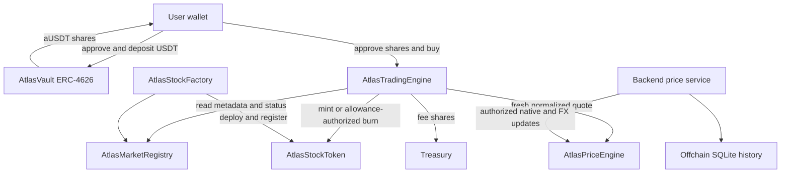

# Atlas demo protocol

This is an immutable, modular synthetic spot-trading POC. AtlasUSDT is a test token, not official Tether. Stock tokens are demo representations without legal equity ownership. No leverage, broker execution or guaranteed market-price redemption is provided.

## Repository baseline and architecture

The inspected repository had a Next.js frontend, Express backend, Sepolia wallet/ENS integration, World ID QR verification and encrypted Arkiv profiles. It had no Solidity project, Atlas Coin contract, USDT contract, deployment scripts or contract roles. The new `contracts/` package adds Foundry with Solidity 0.8.33 and pinned OpenZeppelin 5.4.0. Existing identity flows remain in place.



| Module              | Responsibility                                                                       |
| ------------------- | ------------------------------------------------------------------------------------ |
| AtlasUSDT           | Six-decimal demo ERC-20, role-controlled minting, holder/allowance burning and pause |
| AtlasVault          | Fixed IERC20 settlement asset, proportional ERC-4626 custody and share accounting    |
| AtlasStockToken     | Reusable 18-decimal synthetic ERC-20 with immutable stock ID                         |
| AtlasStockFactory   | Deploy tokens and atomically register metadata                                       |
| AtlasMarketRegistry | Stock metadata, activation and expiring regional market status                       |
| AtlasPriceEngine    | Native prices, USD-per-native FX, timestamps and stale-feed rejection                |
| AtlasTradingEngine  | Spend approved shares, mint/burn stocks, maintain separate stock reserves and fees   |

All modules have interfaces under `src/interfaces/`. There are no proxies or arbitrary vault sweeps. Registry metadata lives outside token contracts. `config/stocks.json` is the source catalog; builds copy it and ABIs into both applications.

## Roles and trust

| Contract                     | Permission               | Holder / effect                                                                              |
| ---------------------------- | ------------------------ | -------------------------------------------------------------------------------------------- |
| Every module and stock token | DEFAULT_ADMIN_ROLE       | Assign/revoke operational roles; default-admin replacement uses a one-day, two-step transfer |
| Demo USDT                    | MINTER_ROLE              | Designated demo distributor; admin is not implicitly a minter                                |
| Demo USDT                    | PAUSER_ROLE              | Pause token transfers, mint and burn                                                         |
| Demo USDT                    | TREASURY_ROLE            | Treasury designation; does not grant spending from other wallets                             |
| Vault                        | PAUSER_ROLE              | Pause deposits/mints; withdrawals remain available if the underlying token permits transfers |
| Registry                     | FACTORY_ROLE             | Factory registers newly deployed stocks                                                      |
| Registry and factory         | MARKET_ADMIN_ROLE        | Metadata, activation, expiring market status and new stock creation                          |
| Price engine                 | PRICE_UPDATER_ROLE       | Publish trusted native and FX observations                                                   |
| Stock tokens                 | MINTER_ROLE, BURNER_ROLE | Trading engine; burning another holder still consumes that holder's allowance                |
| Trading engine               | PAUSER_ROLE              | Pause buys and sells                                                                         |
| Trading engine               | DEFAULT_ADMIN_ROLE       | Set trading fee, capped at 100 bps                                                           |

The deploy script accepts separate admin, updater, market-admin, pauser, minter and treasury addresses. Defaults use the deployer for the MVP. Production requires separated operators and governance. If `ADMIN_ADDRESS` differs, deployment schedules admin transfers on every module and stock token: the new admin must call `acceptDefaultAdminTransfer()` after the one-day delay. The deployer remains default admin until acceptance. There is no automatic transfer completion.

The factory's `setStockAdmin()` rotates the initial administrator of future stock deployments; existing tokens keep their independent administrators. Deployment sets this to the configured final admin after bootstrapping the initial 50 assets. Future tokens need explicit engine mint/burn grants and fresh prices before trading, plus catalog/application updates if they should appear in this fixed 50-asset POC UI.

Trusted admins can reassign mint/burn/oracle roles; malicious authorized minting or prices can damage synthetic market solvency. Prices and market status are centralized, not manipulation-resistant oracles. World ID is enforced by the app login flow, not by these public smart contracts. Anyone can interact directly with contracts. This is not an audited production protocol.

## Units, accounting and storage

| Value                                    | Decimals / representation              |
| ---------------------------------------- | -------------------------------------- |
| Settlement USDT                          | 6 decimals, integer micro-USDT         |
| Vault share aUSDT                        | 12 decimals, ERC-4626 virtual offset 6 |
| Stock quantity                           | 18 decimals                            |
| Native price and USD-per-native FX       | 8 decimals each                        |
| Price timestamps, validity and deadlines | Unix seconds                           |
| Country / currency / region              | bytes2 / bytes3 / bytes32              |

The initial human share price is approximately 1 aUSDT = 1 USDT. It is not fixed. OpenZeppelin's virtual assets/shares give the deposit ratio `(totalSupply + 1e6) / (totalAssets + 1)` in base units. Deposits round shares down; withdrawals round required shares up. Direct donations increase share value. There is no yield strategy. Fee-on-transfer assets are rejected by checking actual transfer deltas; no-return ERC-20 transfers are supported through SafeERC20. Rebasing and otherwise nonstandard settlement assets are outside this POC.

Native price normalization uses integer arithmetic:

```text
usdPrice8 = floor(nativePrice8 * usdPerNative8 / 1e8)
tradeAssets6 = quantity18 * usdPrice8 / 1e20
```

Buy asset amounts round up; sells round down; fees round up. Fees default to 10 bps (0.10%), with a 100 bps maximum. For INR, the input is USD per INR, not INR per USD: `2850 * 0.01204819 = 34.33734150` USD. GBP prices are in pounds, not exchange-feed pence; provider adapters must normalize GBX first. Demo pricing assumes USD/USDT parity.

Prices and FX must be positive, bounded, monotonic by observation timestamp, not future-dated and unexpired. Default maximum age is 900 seconds, configurable from 30 seconds to one day. Changing a stock's feed identifier invalidates its previous observation. Both the stock observation and its FX observation must be fresh. Market status expires within one day and must be renewed; there is no onchain holiday/timezone calendar.

Onchain storage contains current stock metadata, latest native/FX observations, share reserves and cumulative trade amounts. Historical ticks stay offchain. Profile data continues to use Arkiv. Price history uses a separate durable SQLite file with integer prices stored as strings, never floating point. Historical charts use this file and show an empty state until observations exist.

## Trading and liquidity

1. Admin mints/distributes demo USDT using standard ERC-20 calls.
2. User approves the vault and deposits USDT, receiving aUSDT.
3. Buy checks activation, market status, fresh price, deadline, slippage and allowance. The engine takes only the user's approved shares; cost shares enter that stock's reserve, fee shares go to treasury, and synthetic tokens mint to the buyer.
4. Sell checks the same conditions and available stock-specific reserve. It burns the caller's approved stock tokens and transfers net vault shares back. The user may redeem those shares through the vault.

The trading engine cannot withdraw arbitrary vault assets or spend unapproved user shares. Other stocks' reserves cannot fund a sell. If prices rise, a reserve may be insufficient; the transaction reverts atomically without burning the stock. `fundReserve(stockId, shares)` permits voluntary **non-refundable** liquidity contributions, including from admins. It creates no LP claim or right to withdraw. Synthetic prices can fall to a level where a tiny sell rounds to zero and is rejected.

Unspent user shares are available buying power; reserved shares are held by the engine, and settled sell proceeds are returned user shares. There are no pending-order balances. Portfolio P/L is indicative: current holdings value + net cumulative sells − cumulative buy costs including fees. Transfers of stock tokens, unrelated share transfers, and liquidity contributions are not cost-basis tracking; this metric is not a tax/accounting ledger.

## Install and checks

From the repository root:

```sh
npm run setup
npm run protocol:build
npm run protocol:test
npm run protocol:analyze
npm run typecheck
npm run lint
npm test
npm run build
```

Install Foundry first. The wrapper uses a local `solc` 0.8.33 if present, otherwise Foundry downloads the pinned compiler. Tests force compilation so an artifact-only lint cache cannot result in an empty test run. The suite covers mint permissions, all vault entry/exit methods, donation ratios, unauthorized withdrawal, reentrancy, no-return and fee-charging tokens, duplicate assets, FX, stale/invalid observations, fees, approvals, balance, pauses, market closure, slippage and reserve insolvency. Fuzz tests run 256 cases each; the vault invariant runs 128 sequences of depth 64. Static analysis runs Foundry high/medium severity checks; timestamp lint is explicitly excluded because timestamps intentionally enforce freshness and deadlines. This is not a substitute for independent audit.

## Local contract smoke test

In one terminal:

```sh
anvil --silent --port 8545
```

In another terminal, from the repository root:

```sh
npm run protocol:build
npm run deploy:local --prefix contracts
npm run test:smoke --prefix contracts
```

Only local chain 31337 is accepted by the smoke script. It verifies all 50 registrations, deposit/donation/share ratios, buy, profitable sell rejection before reserve funding, funded sell, fee conservation and redemption. Local deploy uses Anvil's unlocked account, not an embedded private key. If restarting a clean chain, explicitly remove or move the old ignored `contracts/deployments/local.json` first. The app frontend deliberately remains Sepolia-only; this smoke tests contracts independently.

## Sepolia deployment and app connection

1. Copy `contracts/.env.example` to `contracts/.env`. Set `RPC_URL`, a **dedicated** `DEPLOYER_PRIVATE_KEY` funded with Sepolia ETH, and optional operator addresses. Never reuse the Arkiv signer or World RP signing key.
2. Build and deploy from the repository root:

```sh
npm run protocol:build
npm run deploy:sepolia --prefix contracts
```

The script checks chain 11155111, deploys modules and 50 stocks, assigns roles, seeds clearly labelled demo prices, opens all five demo markets and writes `contracts/deployments/sepolia.json`. It checkpoints progress in an ignored `.pending.json`; rerun with the same chain, keys, role addresses and settlement asset to resume. An existing final manifest blocks accidental redeployment. Keep checkpoints backed up during deployment. Verify addresses and roles before distribution; separately complete any pending admin transfers.

If vault deployment reports `InvalidSettlementToken()` (`0xa790f950`) immediately after USDT deployment, check that the saved token has code and six decimals on the configured RPC. Public RPC nodes can temporarily disagree about newly mined state. The script disables short-lived read caching and retries constructor gas estimation up to four times before submission. Persistent errors stop with the checkpoint intact; submitted transactions are never retried by that helper. Keep `sepolia.pending.json` and rerun the same deployment command after resolving the error, so the existing USDT address is reused.

Setup calls (role grants, market status, stock creation and price publication) also estimate before reserving a nonce and retry only failed estimates. Errors identify the contract, method and decoded custom error. Market status uses a 23-hour validity window instead of the exact 24-hour contract boundary, leaving room for RPC block-time differences. Initial price observations use a block two behind the head to avoid future-dated observations on lagging estimation nodes. Stock reads wait briefly for newly confirmed registrations to become visible. These measures preserve all onchain validation; no submitted transaction is automatically sent twice.

3. Add to `backend/.env` and restart the backend:

```dotenv
PROTOCOL_DEPLOYMENT_FILE=../contracts/deployments/sepolia.json
PROTOCOL_RPC_URL=https://ethereum-sepolia-rpc.publicnode.com
PRICE_SOURCE=demo
PRICE_UPDATER_PRIVATE_KEY=the_dedicated_authorized_price_updater_key
PRICE_HISTORY_FILE=./data/prices.sqlite
```

4. Run `npm run prices:update` from the repository root. This publishes one snapshot and exits. Schedule it before the 15-minute expiry for continued demo trading. Market status also expires: renew it through Admin → Markets. Demo fixtures are illustrative and do not fetch current market prices. `PRICE_UPDATER_UNLOCKED_LOCAL=true` is supported only on local chain 31337 for smoke testing; it never enables unlocked signing on Sepolia.
5. Start the application with `npm run dev`. Visit `http://127.0.0.1:3000/admin`, connect the authorized wallet and use USDT Treasury to mint/distribute tokens. Each action checks roles onchain. Visit `/vault` and `/trade` with a user wallet after normal World ID/ENS onboarding. Approvals and protocol transactions require MetaMask signatures and Sepolia gas.

Generated ABIs are in `contracts/abi/`, `frontend/src/lib/protocol/abis.json` and `backend/src/protocol/abis.json`. The frontend obtains addresses from `/api/protocol/config`; no signing keys are exposed. All writes simulate, verify account/network, show signature/submitted/confirmed/failed state and link to Sepolia Etherscan. Exact allowances support reset-to-zero tokens. Vault/trade forms apply 0.5% slippage guards and short transaction deadlines.

## Backend data-provider contract

Set `PRICE_SOURCE=http`, `PRICE_PROVIDER_URL` and optional server-only `PRICE_PROVIDER_TOKEN`. The endpoint must return a JSON snapshot matching `PriceSnapshot` in `backend/src/protocol/price-service.ts`:

```json
{
  "source": "your-licensed-provider",
  "demo": false,
  "stocks": [
    {
      "stockId": "the 0x-prefixed catalog ID",
      "ticker": "AAPL",
      "nativePrice": "270.00",
      "currency": "USD",
      "timestamp": 1800000000
    }
  ],
  "fx": [{ "currency": "USD", "usdPerNative": "1", "timestamp": 1800000000 }]
}
```

Use current observation timestamps, decimal strings with at most eight fractional digits, catalog IDs/tickers/currencies and all FX currencies needed by the snapshot. Stock observations may be partial; unrefreshed assets become stale. The provider adapter fetches, validates, normalizes and submits two onchain batches (FX then stocks); history is recorded after confirmation. These two transactions are not atomic together: if the second fails, refresh with a newer full snapshot and investigate before trading. No private-key admin HTTP endpoint is exposed. API reads are `/api/protocol/catalog`, `/api/protocol/config`, and `/api/protocol/history/:stockId?limit=100` (maximum 500 rows).

## Admin and user screens

The separate `/admin` shell has Dashboard, USDT Treasury, Price Engine, Stocks, Markets, Vault, Transactions and Roles tabs. Mint is visible only to MINTER_ROLE. Transfers spend the connected account's own balance. The price table shows native, FX and USDT prices, timestamps and status; authorized operators can update prices/batches and disable assets. Transactions shows recent ERC-20 events over a bounded block range, not an exhaustive indexed ledger. The vault shows TVL, shares and depositor count; count means unique historical depositing receivers, not verified platform users. Roles manages operational grants/revocations; delayed default-admin changes use the contract directly.

`/vault` shows wallet USDT, share claim, share price and buying power with deposit, asset withdrawal and share redemption. `/trade` shows the five markets, 50 assets, balances, reserves, quotes, stock/country allocations and indicative P/L. The dashboard includes an actual protocol balance summary; pre-existing illustrative portfolio cards retain their demo data. Open trading and admin screens mark expired observations unavailable on a 15-second clock; contracts independently reject stale quotes at execution.

## Real USDT and production boundary

Set `SETTLEMENT_TOKEN_ADDRESS` to an existing six-decimal ERC-20 when deploying a **new** vault and engine. The vault is written against IERC20/ERC-4626, not AtlasUSDT. The demo mint/pause controls are hidden for an external settlement token. A funded vault's immutable underlying must never be swapped in place: existing users redeem, and migrate into the new configured vault with explicit approval. Existing deployments and liabilities require a migration plan.

Production additionally needs regulated brokerage/custody and licensed execution, compliant security issuance and transfer restrictions, jurisdiction/KYC rules, audited contracts, resilient oracle adapters, genuine market calendars, liquidity/risk capital, reliable price-data licensing, persistent shared sessions/identity replay storage and operational monitoring. Those systems are intentionally outside this demo. A synthetic token and an admin price feed do not create ownership of the named company's stock.
