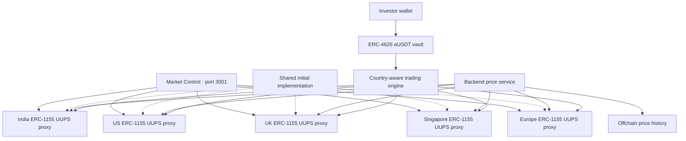

# Atlas country protocol (v2)

The current architecture has **five upgradeable market proxies**, one each for India, United States, United Kingdom, Singapore and Europe. Europe is a market region rather than one country. Each proxy holds many stock IDs in an ERC-1155 ledger; onboarding another stock does not deploy a contract. ERC-1155 amounts use 18 decimal units throughout Atlas.

The independent **Market Control** application lives in `admin/` and runs at `http://127.0.0.1:3001`. The investor application stays at port 3000, with World ID QR verification, ENS and Arkiv profiles. `/admin` in the investor app only redirects to the separate application; it no longer bundles an admin dashboard.

## Architecture



Five means five **market ledger addresses**, not five total protocol deployments. There is also one shared initial implementation, a trading engine, USDT and a vault. Existing compatible USDT/vault deployments can be reused explicitly. Proxies start on the same implementation but can be upgraded independently by their respective owners.

| Contract                    | Purpose                                                                                                    |
| --------------------------- | ---------------------------------------------------------------------------------------------------------- |
| `AtlasCountryMarket`        | Upgradeable stock registry, ERC-1155 balances/supply, native/FX/USDT prices, market status and permissions |
| `AtlasCountryProxy`         | ERC-1967 proxy initialized atomically with its owner, region and currency                                  |
| `AtlasCountryTradingEngine` | Approved vault-share settlement, country-specific stock reserves, fees, buy/sell, mint/burn coordination   |
| `AtlasVault`                | Existing six-decimal IERC20 custody and proportional ERC-4626 shares; no arbitrary admin withdrawal        |
| `AtlasUSDT`                 | Six-decimal demo token; not official Tether USDT                                                           |

The previous 50-ERC-20 design remains available for inspecting or servicing existing deployments. See [LEGACY_PROTOCOL.md](LEGACY_PROTOCOL.md). The default deployment and price-update commands now target v2.

## Ownership and delegated access

The deploying account is the initial country owner. Optional `ADMIN_ADDRESS` schedules a two-step transfer to another owner after setup. The new owner must connect to Market Control → Access and accept. Until then the deployer remains owner. Ownership cannot be renounced through this implementation.

| Permission                | Functions                                                                                                                 |
| ------------------------- | ------------------------------------------------------------------------------------------------------------------------- |
| Owner only                | Grant/revoke business roles, change engine, change maximum price age, propose ownership transfer, authorize UUPS upgrades |
| `ADMIN_ROLE`              | Stock, pricing, market-status and pausing operations; cannot grant roles, change owner/engine, change max age or upgrade  |
| `STOCK_ADMIN_ROLE`        | Batch onboarding, company/feed updates, stock activation                                                                  |
| `PRICE_UPDATER_ROLE`      | Atomic stock/native-FX/USD-USDT snapshot publication                                                                      |
| `MARKET_ADMIN_ROLE`       | Open/close/renew market status                                                                                            |
| `PAUSER_ROLE`             | Pause/unpause the country ledger, including ERC-1155 transfers/mint/burn                                                  |
| Configured trading engine | Mint stocks on buys; burn caller-authorized stocks on sells                                                               |

Roles are scoped to one country proxy. Revocation is immediate on confirmation. Ownership changes do not automatically revoke existing delegated roles; review them during handover. Country admins cannot mint arbitrary stock balances. The owner can replace the engine or upgrade the implementation and therefore remains a powerful trusted party; production should use reviewed governance/multisig controls.

USDT/vault/engine retain their own OpenZeppelin AccessControl permissions. Country ADMIN_ROLE does not automatically grant USDT minting rights. Market Control → Treasury exposes standard transfers, authorized demo minting and owner/admin-controlled minter grants on the settlement token.

## Stock onboarding and units

The seed catalog contains ten stocks in each market, 50 total. Each stores a stock ID, ticker, company, country code, exchange, price-feed identifier and active flag. `onboardStocks()` adds 1–100 entries atomically. Duplicate IDs or exchange/ticker pairs revert. A stock without a fresh published observation cannot trade. Changing its feed identifier invalidates its existing observation.

Market Control supports single and JSON batch onboarding. IDs follow `keccak256(region + ':' + exchange + ':' + ticker)` in the dashboard. The backend and investor frontend discover IDs and metadata onchain, so newly onboarded stocks appear without editing the original seed JSON. POC readers support up to 1,000 stocks per country and use paginated ID reads; expand pagination/UI before exceeding that bound.

| Value                                                | Decimals                                                                                     |
| ---------------------------------------------------- | -------------------------------------------------------------------------------------------- |
| USDT assets                                          | 6                                                                                            |
| aUSDT vault shares                                   | 12 (ERC-4626 offset 6)                                                                       |
| Stock quantities                                     | 18; stored under an ERC-1155 token ID equal to the stock's bytes32 ID interpreted as uint256 |
| Native prices, USD per native currency, USD per USDT | 8                                                                                            |

ERC-1155 has no ERC-20-style `decimals()` method. Atlas consistently treats each stock unit as 1e18 base units. Wallet software may display these multi-token holdings differently from ERC-20 assets.

## Prices, fluctuations and USD/USDT

Each market accepts an atomic batch of stock native prices plus **USD per native currency** and **USD per USDT** observations. All have an observation timestamp and validity window. The authorized service updates snapshots as market feeds change; manual wallet updates are available in Market Control.

```text
stockUSD8  = floor(nativePrice8 * usdPerNative8 / 1e8)
stockUSDT8 = floor(stockUSD8 * 1e8 / usdPerUSDT8)
tradeUSDT6 = quantity18 * stockUSDT8 / 1e20
```

For example, a stock worth $270 costs about 275.51020408 USDT when one USDT is worth $0.98. USD and USDT are not hardcoded equal. The explicitly labelled demo source uses USD/USDT = 1 and illustrative stock/FX fixtures. INR input is USD per rupee, not rupees per dollar. UK prices must be in GBP, not GBX/pence. One currency applies per market proxy.

Freshness defaults to 900 seconds and can be set by the owner between 30 seconds and one day. Trades validate the stock observation and the shared FX/USDT observations. Zero/invalid prices, future timestamps, stale inputs, disabled stocks and timestamp rollback are rejected. Native observations strictly advance; all updates in a transaction are atomic. Price movement does not mint unbacked USDT or guarantee trading liquidity.

The backend provider adapter fetches decimal-string snapshots, validates mapping and time, calculates exact integer USD/USDT prices, publishes one transaction per affected country and records confirmed history offchain. `prices:watch` refreshes every minute. Real market data requires a configured HTTP provider; demo mode does not fetch live prices or invent fluctuations.

Historical ticks are stored in SQLite, separate from Arkiv identity/profile records. History API reads also observe confirmed onchain quotes so manual dashboard publications can be recorded. This is snapshot history, not a complete event indexer: intermediate changes between observations can be missed. Existing history files migrate by adding a USDT-price column; older entries retain their original USD/parity display.

## Trading and custody

Users approve/deposit USDT into the vault and receive proportional aUSDT shares. Buys spend approved shares, route fee shares to treasury, reserve cost shares for that country/stock pair, and mint the corresponding ERC-1155 quantity. Sells require explicit ERC-1155 `setApprovalForAll(engine, true)` for the selected country and return net vault shares. Approval covers all stock IDs within that country; revoke it in the wallet when no longer needed. The fixed engine only burns the selling caller's requested position.

The engine is allowed once per country, not granted mint/burn roles 100 times. Reserve keys include both country address and stock ID, isolating markets. Sells revert before burning if their own reserve is insufficient. Voluntary `fundReserve(country, id, shares)` contributions are non-refundable and create no LP claim. Profit realization may need additional reserve capital. There is no leverage, legal stock custody or promise of unlimited market-price redemption.

Vault accounting is unchanged: OpenZeppelin virtual assets/shares, initially about one human aUSDT per USDT, with proportional conversions after donations. Deposits round down; required withdrawal shares round up. Buy values and fees round up, sells round down. Default fee is 10 bps with a 100 bps cap. No admin sweep exists. An underlying-token pause may prevent vault exits despite the vault itself allowing withdrawals.

## Install, run and validate

Requires Node 22.13+, npm and Foundry. Solidity is pinned to 0.8.33 and OpenZeppelin Contracts/Upgradeable to 5.4.0.

```sh
npm run setup
npm run protocol:build
npm test
npm run protocol:analyze
npm run upgrade:validate
npm run typecheck
npm run lint
npm run build
# Disposable Anvil deployment, 50-stock flow, new-stock onboarding,
# backend publisher and config/catalog/history integration:
npm run protocol:smoke
```

Run the applications in separate terminals:

```sh
npm run dev          # backend 4000 + investor frontend 3000
npm run dev:admin    # separate Market Control application 3001
```

The dashboard proxies `/api` to backend port 4000 in development. Set `VITE_API_TARGET` in `admin/.env.local` for another backend. Production hosting must proxy `/api` to the backend too. No server private key belongs in `VITE_*` or `NEXT_PUBLIC_*`. Admin authentication is wallet possession plus onchain authorization; it does not share investor sessions, World ID onboarding or an owner password. All reads are public; writes simulate and require wallet approval on Sepolia.

## Sepolia deployment

**This architecture requires a new deployment. Existing ERC-20 stock contracts cannot become these proxies in place.** The scripts do not burn/migrate old positions, move reserves or alter existing country deployments automatically.

Copy `contracts/.env.example` to `contracts/.env` if absent. Configure a dedicated funded Sepolia deployer:

```dotenv
RPC_URL=https://ethereum-sepolia-rpc.publicnode.com
DEPLOYER_PRIVATE_KEY=server_only_dedicated_test_wallet_key
# Optional: defaults to deployer; a different owner must accept transfer.
ADMIN_ADDRESS=
TREASURY_ADDRESS=
PRICE_UPDATER_ADDRESS=
COUNTRY_ADMIN_ADDRESS=
```

To explicitly reuse the previously deployed Atlas USDT and vault, add their addresses from the old manifest:

```dotenv
SETTLEMENT_TOKEN_ADDRESS=old_atlasUSDT_address
EXISTING_VAULT_ADDRESS=old_atlasVault_address
SETTLEMENT_TOKEN_IS_DEMO=true
```

Leave both addresses empty for a new demo token/vault. Set `SETTLEMENT_TOKEN_IS_DEMO=false` for a real externally supplied token. Reusing a vault preserves user shares and existing assets, but does not migrate stock positions or reserves held by the old engine. Its asset must match the selected six-decimal token. Reused contracts keep their existing ownership and permissions.

```sh
npm run protocol:build
npm run upgrade:validate
npm run deploy:sepolia --prefix contracts
```

The script deploys one implementation, five proxies and one engine, plus USDT/vault when not reused. It onboards ten stocks per country in five batches, configures each engine permission, seeds demo prices and opens 23-hour demo sessions. It logs transaction hashes/confirmations and checkpoints submitted deployment addresses/hashes before waiting. Network, role/settings and existing-manifest guards prevent accidental reuse with another configuration.

Final manifest: `contracts/deployments/sepolia-v2.json`. Pending checkpoint: `sepolia-v2.pending.json`. Keep the pending file and rerun the same command after a failure. Constructor/setup estimates retry before sending; submitted transactions are not automatically resubmitted. Do not run concurrent deploy processes for the same signer. Legacy deployment files are preserved and are not accepted as v2 app configuration.

Gas estimates are padded by 25% and checked with a read-only execution before submission. If an underestimated budget runs out of gas, the script increases and verifies it before sending. The default total-budget ceiling is the smaller of the live block allowance and 50,000,000 gas. It is not hardcoded to the old execution-gas ceiling: current Sepolia state-creation accounting can require a higher total transaction budget ([EIP-8037](https://eips.ethereum.org/EIPS/eip-8037)). Contract reverts with error data are preserved immediately. Large batches may need splitting to fit the budget. A reverted setup transaction reports its method, hash and receipt gas usage; resuming checks existing onchain stock state before onboarding again. Upstream RPC reasons and the deployment/setup step are included in failures.

Configure `backend/.env` and restart the backend:

```dotenv
PROTOCOL_DEPLOYMENT_FILE=../contracts/deployments/sepolia-v2.json
PROTOCOL_RPC_URL=https://ethereum-sepolia-rpc.publicnode.com
PRICE_UPDATER_PRIVATE_KEY=dedicated_authorized_updater_key
PRICE_SOURCE=demo
PRICE_HISTORY_FILE=./data/prices.sqlite
```

Use the key for `PRICE_UPDATER_ADDRESS`; when blank during deployment, the deployer is authorized through ownership. Keep all signing keys server-only; do not reuse World ID or Arkiv service keys. After ownership transfer, the old owner may need an explicit price-updater grant. Then:

```sh
npm run prices:update    # one snapshot
npm run prices:watch     # refresh loop, one minute
npm run dev:admin
```

Renew market sessions through Overview before expiry. `prices:watch` does not automatically reopen closed markets or override a manual pause.

## Live HTTP price provider

Set `PRICE_SOURCE=http`, `PRICE_PROVIDER_URL` and optional `PRICE_PROVIDER_TOKEN` on the backend. Return:

```json
{
  "source": "your-authorized-market-feed",
  "demo": false,
  "stocks": [
    {
      "stockId": "0x-prefixed-onchain-stock-id",
      "ticker": "AAPL",
      "nativePrice": "270.00",
      "currency": "USD",
      "timestamp": 1800000000
    }
  ],
  "fx": [{ "currency": "USD", "usdPerNative": "1", "timestamp": 1800000000 }],
  "usdt": { "usdPrice": "0.9998", "timestamp": 1800000000 }
}
```

Use current timestamps, up to eight decimal places, onchain stock mappings, and FX currencies required by the included stocks. Provider snapshots must explicitly include USD/USDT; only demo snapshots allow the parity fallback. One snapshot supports up to 100 stocks; split larger universes into batches. Already published/older observations are skipped. Closed markets can receive fresh prices but cannot trade. Disabled stocks are not published by the service. Each country update is atomic; updates across countries are separate transactions and history is saved per successful country.

The updater currently uses a private-key signer for this POC. Deploy a managed signer, monitoring, feed redundancy, licensed data, market calendars and a transactional operational process before production. A trustless oracle adapter is not implemented.

## Upgrade validation and execution

The implementation is locked against direct initialization; each proxy initializes once. Only its owner can call UUPS `upgradeToAndCall`. Owner transfers are two-step. State storage, including ERC-1155 balances, stock records, prices and delegated roles, stays in the proxy. Changing that storage layout incompatibly can corrupt state.

`npm run upgrade:validate` checks the current implementation's UUPS/initializer safety. **It does not compare a future implementation against your deployed release unless a reference is supplied.** Preserve the release's complete `out/build-info` directory before changing code. After building the new version, run OpenZeppelin's validator with the actual old release as reference, for example:

```sh
# Copy these files BEFORE editing/rebuilding the deployed release:
cp -R contracts/out/build-info /tmp/atlas-country-v1
# After implementing AtlasCountryMarketV2 and building:
node contracts/node_modules/@openzeppelin/upgrades-core/dist/cli/cli.js validate \
  contracts/out/build-info \
  --contract src/AtlasCountryMarketV2.sol:AtlasCountryMarketV2 \
  --reference atlas-country-v1:src/AtlasCountryMarket.sol:AtlasCountryMarket \
  --referenceBuildInfoDirs /tmp/atlas-country-v1 \
  --requireReference
```

Also run state-preservation and trading tests against the new implementation. Deploy the validated implementation separately. In Market Control → Upgrades, select the country proxy and enter that implementation address. The dashboard checks code/UUPS compatibility and asks the owner to confirm storage validation, but cannot prove an offchain validation report. The wallet transaction upgrades only that proxy, with empty migration calldata; upgrades requiring a reinitializer/migration call must use reviewed `upgradeToAndCall` calldata directly instead. Independent review is required for production upgrades.

The helper can validate against a preserved reference and deploy only the candidate implementation using the dedicated deployer key:

```sh
npm run upgrade:prepare --prefix contracts -- \
  src/AtlasCountryMarketV2.sol:AtlasCountryMarketV2 \
  atlas-country-v1:src/AtlasCountryMarket.sol:AtlasCountryMarket \
  /tmp/atlas-country-v1
```

It stops if validation fails, supports Sepolia only and never upgrades a proxy itself. Review its resulting implementation address in Market Control with the owner wallet.

References: [OpenZeppelin ERC-1155](https://docs.openzeppelin.com/contracts/5.x/erc1155), [UUPS proxy API](https://docs.openzeppelin.com/contracts/5.x/api/proxy), [writing upgradeable contracts](https://docs.openzeppelin.com/upgrades-plugins/writing-upgradeable).

## POC boundaries

These are synthetic test assets, not legal ownership of the named equities. World ID remains an investor app gate, not onchain compliance. Country owners and price operators are trusted. Prices can fluctuate independently of funded reserves. ERC-1155 transfers do not carry cost-basis history, so displayed P/L is indicative rather than an accounting ledger. Contracts and dashboards have automated/local checks, but require an external security audit, real data integration and interactive wallet testing before production use.

The upgrade-validator development dependency tree currently reports two moderate and four low npm audit advisories (minimatch/legacy cryptography dependencies). These are contract build/validation tools rather than application runtime dependencies. Review the upstream advisories and available tooling updates before production use; passing upgrade/storage checks is not an application dependency audit.
